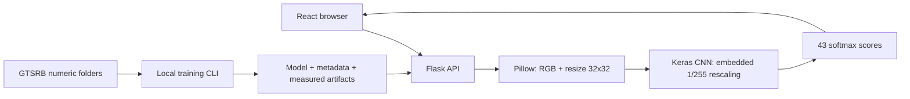

# SignalLab — Traffic Sign Recognition

Artificial Intelligence · Micro Project 06 · CO2, CO3, CO5

A minimal React/TypeScript website with a Flask API and reproducible TensorFlow CNN training code. It has **exactly three pages**:

1. **Recognition** — upload or replace a cropped traffic-sign image; display the predicted class, softmax score, top five predictions and inference time.
2. **Model & Training** — a short CNN explanation and actual accuracy/loss curves when artifacts exist.
3. **Dataset** — a short GTSRB introduction, workflow and measured sample counts when configured. Detailed setup remains in this README.

There are no separate overview, class gallery, evaluation, viva, documentation or team pages. Prediction history and illustrative sample cards have been removed. Real dataset samples remain available in the uploader after training exports them.

**The repository includes a trained GTSRB baseline model and its measured artifacts** in `backend/artifacts/`. Its held-out, track-grouped validation accuracy is 96.68%; this is not an independent official-test result. The model recognizes the 43 GTSRB classes only. The Vercel deployment remains a lightweight frontend/API build without TensorFlow or model weights; run the local backend with the full requirements to use the included model.

## Architecture



The training and inference pipeline is shared in `backend/predict.py`. During inference, a dominant compact, saturated region is cropped automatically when it can be distinguished from the rest of the photo; ambiguous scenes keep the full image. Pillow produces raw float32 RGB pixels in 0–255; the CNN normalizes exactly once with its own Rescaling layer. The class mapping uses numeric IDs 0–42. Model loading verifies the checksum, class ordering, shapes, embedded rescaling and softmax output.

## Project files

```text
traffic-sign-recognition/
├── README.md
├── VERIFICATION.md
├── .env.example
├── .gitignore
├── .vercelignore
├── vercel.json
├── pyproject.toml                  # Hosted Python API dependencies
├── requirements.txt              # Lightweight hosted API requirements
├── api/index.py                  # Vercel Flask entrypoint
├── backend/
│   ├── app.py
│   ├── class_names.py
│   ├── classes.json
│   ├── model_loader.py
│   ├── predict.py
│   ├── train.py
│   ├── evaluate.py
│   ├── requirements.txt          # Full local ML dependencies
│   ├── requirements-api.txt
│   ├── tests/test_api.py
│   └── artifacts/
│       ├── traffic_sign_cnn.keras
│       ├── model_metadata.json
│       └── evaluation_metrics.json
└── frontend/
    ├── package.json
    ├── package-lock.json
    ├── index.html
    ├── tsconfig.json
    ├── vite.config.ts
    ├── tailwind.config.js
    ├── postcss.config.js
    └── src/
        ├── main.tsx
        ├── App.tsx
        ├── index.css
        └── data/
            ├── classes.json      # Mapping consistency test
            └── project.ts        # Optional academic metadata; no separate UI
```

Dependencies, datasets and temporary test fixtures are excluded from the ZIP. The trained baseline model and its generated artifacts are tracked in this repository.

## Run locally on Windows

Install **64-bit Python 3.12** (3.11 also works for local ML) and **Node.js 22 LTS**. Extract the ZIP into a folder such as `C:\Projects\traffic-sign-recognition`. Use Command Prompt.

### Terminal 1: backend

```bat
cd C:\Projects\traffic-sign-recognition\backend
py -3.12 -m venv .venv
.venv\Scripts\activate
python -m pip install --upgrade pip
pip install -r requirements.txt
python app.py
```

The API runs at `http://127.0.0.1:5001`. `/api/health` reports whether a real model is loaded. For educational browsing without TensorFlow, install `requirements-api.txt` instead; training needs the full requirements.

### Terminal 2: frontend

```bat
cd C:\Projects\traffic-sign-recognition\frontend
npm ci
npm run dev
```

Open `http://127.0.0.1:5173`. Vite proxies `/api` to Flask. Keep both terminals open. PowerShell users can invoke `.venv\Scripts\python.exe` directly if activation is restricted.

## Configure GTSRB

Download training images from the [official GTSRB page](https://benchmark.ini.rub.de/gtsrb_dataset.html) and follow its current usage terms. Extract the directory containing the 43 numeric class folders into:

```text
backend/data/Train/
  00000/00000_00000.ppm
  00000/00000_00001.ppm
  00001/...
  ...
  00042/...
```

`--data` must point directly to the parent of the numeric folders. Folder names such as `0` or `00000` both work, but each ID must occur exactly once. Labels are inferred from folder IDs, not alphabetic sorting or CSV order.

Keep original track-based filenames. Consecutive GTSRB frames can show the same physical sign; the script groups filenames by their first two underscore-separated fields (class and track ID), so frames from one track stay entirely in either training or validation. Each class is split independently with a requested 20% validation fraction, ensuring both splits contain every class when each class has at least two tracks. The realized sample fraction can differ because tracks contain different numbers of images.

Supported input formats: JPEG, PNG, WebP, BMP and PPM. Training reads the decoded dataset into RAM. Corrupt images stop training instead of being silently skipped.

## Train and connect the CNN

From an activated backend terminal:

```bat
python train.py --data data/Train --epochs 20 --batch-size 64 --validation-split 0.2 --learning-rate 0.001
```

Training runs only through this terminal command; the website does not include training controls or status cards. Optional CLI ranges: epochs 1–200; batch size 8–512; validation fraction 0.1–0.4; learning rate 0.000001–0.01.

Architecture: Input(32,32,3) → Rescaling(1/255) → Conv32/ReLU/Pool → Conv64/ReLU/Pool → Conv128/ReLU/Pool → Flatten → Dense128/ReLU → Dropout(0.5) → Dense43/Softmax. Convolutions use 3 × 3 kernels with same padding. Compile: Adam, sparse categorical cross-entropy and accuracy. Seed 42 and deterministic operations are requested. Hardware/library differences can still affect reproducibility.

Early stopping monitors validation loss with patience 5. A checkpoint saves the best epoch, which is reloaded for validation evaluation. Generated files in `backend/artifacts/` include:

- `traffic_sign_cnn.keras` and `best_checkpoint.keras`
- `model_metadata.json` with checksum, class names and preprocessing contract
- `training_history.json`, `evaluation_metrics.json`, `confusion_matrix.json`
- `dataset_metadata.json`, `training_status.json`
- `samples/0.png` through `samples/42.png`, real examples from the configured dataset

**Restart the local backend after training completes**, then refresh the interface. Model loading happens once at startup. Copy the model and metadata together when moving machines. Do not start a fresh backend while training is replacing these artifacts. A lock prevents simultaneous training jobs; after a crash, remove `training.lock` only after confirming no training process remains.

A failed run reports its error and can leave artifacts from a previous run. Check status and file timestamps before reporting results. No fake model is substituted.

Validation is used for checkpoint selection and is **not an independent test**. To evaluate a separate labelled test set, arrange its images into the same 43 numeric folders using ground-truth labels, then run:

```bat
python evaluate.py --test-data data/Test --output test-results
```

These test artifacts are kept separate. Detailed confusion matrices and classification reports remain exported JSON files; the minimal interface displays training/validation curves and summary metrics only.

## API

| Route | Purpose |
|---|---|
| GET `/api/health` | Backend and model availability |
| GET `/api/classes` | Fixed 43-class mapping |
| POST `/api/predict` | Multipart `image`; real top class, top five scores and measured time |
| POST `/api/preview` | Safely convert PPM/other supported images to a bounded PNG preview |
| GET `/api/metrics` | Availability and contents of saved training, evaluation and dataset metadata |
| GET `/api/model-info` | Actual loaded architecture and parameter counts |
| GET `/api/train/status` | Most recently written local training status |
| POST `/api/train` | 405; training is supported through the CLI |
| GET `/api/samples` | Dataset examples exported by training |
| GET `/api/samples/<class_id>` | Fixed numeric sample lookup |
| GET `/api/confusion-matrix` | Exported matrix, retained for programmatic use |

```bat
curl.exe -F "image=@C:\Images\sign.png" http://127.0.0.1:5001/api/predict
```

Successful fields: `class_id`, `class_name`, `score` (0–1), `top_k` (five entries), `inference_ms`, `score_type: softmax`. Scores are actual model outputs, not guarantees of correctness. Timing includes array preprocessing and the model call, excluding upload, decoding and network time.

Errors: 400 missing/corrupt image; 413 oversized request; 429 model busy; 503 model unavailable; 500 unexpected server error. The browser accepts files under 4 MB; Flask limits the entire multipart request to 5 MB; Vercel has its own independent body limit. Pillow checks decoded formats and decompressed dimensions. Uploads are not executed or permanently stored. Current image/result state lives in page memory; no history or login is required. Browser requests time out after 30 seconds.

## Vercel

Live project: https://signallab-traffic-sign-recognition.vercel.app

`vercel.json` builds `frontend/dist` and forwards `/api/*` to `api/index.py`, reusing the Flask API. Python dependencies are declared in `pyproject.toml`. The deployed educational API is lightweight: **TensorFlow and trained weights are not installed**. It correctly reports model unavailable and does not connect to your laptop’s localhost server.

To enable hosted inference, train locally, then deploy trusted weights/metadata with a TensorFlow-capable runtime, or configure an external inference service and proxy `/api` to it. Validate dependency size, runtime resources and upload limits first. Training stays local; the serverless filesystem is not a persistent training workspace. Existing Vercel access protection is preserved, so a Vercel login may be required.

`.env.example` documents `FRONTEND_ORIGIN` for development CORS; it is not automatically loaded. No API secrets are required.

## Test and demonstrate

```bat
cd frontend
npm run build
cd ..\backend
.venv\Scripts\activate
python -m pytest tests -q
```

See `VERIFICATION.md` for executed checks and limits.

Faculty checklist:

- [ ] Configure GTSRB, train locally and keep all real artifacts.
- [ ] Confirm health reports a loaded model before claiming recognition is operational.
- [ ] Upload a cropped sign; explain its class, softmax score and top predictions.
- [ ] Replace/remove the image and demonstrate meaningful errors.
- [ ] Open Model & Training; explain convolutions, pooling, normalization and the training command.
- [ ] Show real curves and discuss validation selection bias.
- [ ] Open Dataset; explain 43 classes, track grouping, preprocessing and imbalance.
- [ ] State limitations: cropped German signs only; no road-scene detection or driving control.

## Troubleshooting

- TensorFlow install failure: use 64-bit Python 3.11/3.12 and a fresh environment; update pip.
- Backend offline: start `python app.py` and confirm port 5001 matches the Vite proxy.
- Model missing/error: finish training, keep metadata with weights, verify version/checksum and restart Flask.
- Missing metrics: training must complete; use the header refresh control or reload the page. The hosted build needs artifacts deployed separately.
- Dataset missing: point `--data` directly to all 43 numeric folders and preserve original filenames.
- Split missing classes: supply more independent tracks and inspect folder contents.
- PPM preview failure: the Python API must be running for browser conversion.
- npm cache permissions: use a writable cache, e.g. `npm ci --cache .npm-cache`.
- Port occupied: stop the older server or update Flask and Vite consistently.

## Limits and references

This is an educational prototype, not validated for safety-critical driving. Inference can crop a dominant compact, saturated region as a basic sign-localization aid, but it is not a general road-scene object detector. Blur, lighting, occlusion, other colorful objects and unfamiliar signs can cause confident mistakes. The reported validation accuracy is not an independent test result or a safety claim.

- [Official GTSRB dataset](https://benchmark.ini.rub.de/gtsrb_dataset.html)
- Stallkamp, J., Schlipsing, M., Salmen, J., and Igel, C. (2011). *The German Traffic Sign Recognition Benchmark: A multi-class classification competition*. IJCNN. [DOI](https://doi.org/10.1109/IJCNN.2011.6033395).
- [TensorFlow Rescaling](https://www.tensorflow.org/api_docs/python/tf/keras/layers/Rescaling)
